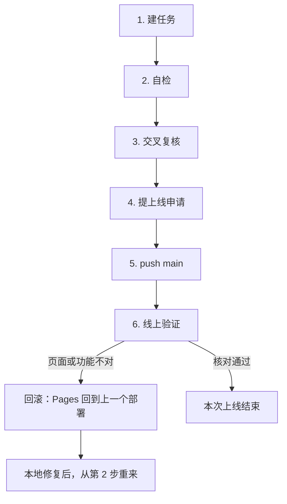

# 上线流程

站点部署在 Cloudflare Pages，正式地址是 [https://aikevin.dpdns.org](https://aikevin.dpdns.org)。Pages 跟踪 `main`：合并进 `main` 并 push 之后会自动构建、上线。不要从功能分支直接部署。

发布前的顺序是：建任务、自检、交叉复核、上线申请、push `main`、线上验证。前三步没过，不要 push。



## 1. 建任务

从最新的 `main` 拉出功能分支，写下这次要改什么、不改什么、怎么算做完。一个任务对应一个分支。

## 2. 自检

在功能分支上改完，于仓库根目录跑：

```bash
npm test
python3 validate_site.py
```

改过正文或新增页面时，再跑 `python3 generate_search_index.py` 和 `python3 generate_sitemap.py`，并把生成结果一起提交。站点地图脚本会合并保留现有 `/projects/` 条目及其元数据，不从 projects 目录重建；禁止手工删除这些条目后裸跑脚本指望自动找回。用 `python3 -m http.server 8000` 打开改动过的页面，核对导航、筛选、图片和窄屏布局。`npm test` 或校验有失败，停在这一步。

## 3. 交叉复核

把分支和 diff 交给复核人。只核对三件事：改动是不是任务里写的那件事，有没有改到不该改的页面，自检命令是不是真的跑过。复核没有书面结论之前，不进入下一步。

## 4. 提上线申请

自检和交叉复核都过之后，向上线审批人申请上线。申请里写清分支、提交范围、验收方式、回滚点。审批同意之前，不合并、不 push。

## 5. push main

把功能分支合并进 `main` 再 push。Cloudflare Pages 会按仓库根目录构建；这次没改 CSS 时，构建命令保持为空。push 之后到 Pages 控制台确认这一次部署的提交就是刚推上去的那个。

## 6. 线上验证

部署状态变成成功后，打开正式站核对这次改动的页面。再随机打开一个不存在的路径，确认返回的是自定义 404，而不是别的页面。改过照片或回忆录时，再点开一张图、调一次列表。

对不上就回滚，不要在线上接着改：

1. 打开 Cloudflare Pages 该项目的 Deployments。
2. 选上一个成功部署，执行 Rollback to this deployment。正式站会回到那一次的文件，`main` 上的提交还在。
3. 在功能分支修复，从第 2 步重新走。确认无误后再 push `main`。

回滚只恢复 Pages 上的文件。R2 里已经删掉或覆盖的对象不会跟着回来，所以删照片、改第二大脑文件之前先留下原文件。
