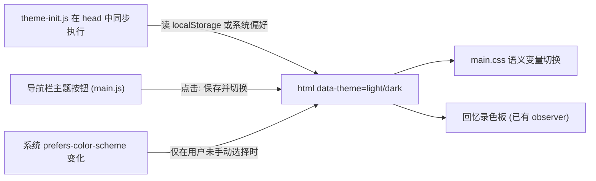

# 全站深色模式切换

> 日期：2026-10-24
> 目标：让使用公共样式的页面支持深色模式。默认跟随系统，导航栏按钮可以手动覆盖并记住选择。
> 范围：首页、文章、文章列表、关于、最近在做、旅行与游记、认知武器总览、回忆录、404。
> 不在本期范围：咖啡角（`coffee*.html`）和 108 篇 `projects/` 页面，保持现有浅色视觉。

## 现状

- [`scripts/theme.js`](../../scripts/theme.js) 是旧版主题脚本（蓝色强调、圆形浮动按钮、运行时注入样式），**没有任何页面加载它**，只出现在 [`service-worker.js`](../../service-worker.js) 的缓存列表里。
- [`styles/main.css`](../../styles/main.css) 已有 `--bg-primary`、`--text-primary`、`--border-color` 等变量，但大部分规则直接写死 `#0a0a0a`、`#fff`、`#4a4a4a`（约 115 处）。其他样式文件同样有大量写死的颜色：[`styles/travel.css`](../../styles/travel.css) 约 140 处，`article.css`、`search.css`、`travel-journal.css`、`blog.css`、`about.css`、`motion.css` 各有几十处。
- 已经接入 `data-theme` 的地方：照片降亮规则（`main.css` 末尾），以及回忆录 [`scripts/memoir-cutout.js`](../../scripts/memoir-cutout.js) 通过 MutationObserver 监听 `data-theme="dark"` 切换 `DARK`/`LIGHT` 色板。
- 公共导航 `.site-nav` 里已有静态的 `.nav-toggle`（带 `hidden`，由 JS 启用）和 `.search-trigger`，主题按钮可以照同样方式放进去。

## 方案

`<html>` 上始终有明确的 `data-theme` 值，CSS 只需要写 `:root[data-theme="dark"]` 一套规则，回忆录现有逻辑也能直接生效。禁用 JS 时页面显示浅色（即当前效果）。

### 1. 颜色变量化（工作量最大）

- 在 `styles/main.css` 的 `:root` 中定义语义变量：
  - `--paper`：页面底色
  - `--surface`：卡片/白底
  - `--surface-muted`：标签灰底（`#e9e9e3`）
  - `--ink`：文字、边框、硬阴影
  - `--ink-muted`：次要文字（`#4a4a4a`）
  - `--on-ink`：深色按钮上的文字
  - `--grid-line`：首页网格（`#0a0a0a08`）

  `--shadow-small/medium`、`--border-color` 等旧变量改为引用这些新变量。
- 新增 `:root[data-theme="dark"]` 覆盖块，同时设置 `color-scheme: dark`。深色色板保持 Neo-Brutalism 风格：
  - 近黑底 `#121210`，卡片 `#1c1c19`
  - 米白文字和边框 `#ecebe4`（硬边框和硬阴影改为浅色）
  - 橙色 `#ff4d00` 不变；蓝和绿适当提亮，正文对比度目标 4.5:1
- 逐个文件把写死的颜色替换成变量：`main.css`、`article.css`、`blog.css`、`about.css`、`search.css`、`travel.css`、`travel-journal.css`、`motion.css`。
- [`tailwind.config.cjs`](../../tailwind.config.cjs) 中的 `brand` 颜色改为 `var(--…)`，再运行 `npm run build` 重新生成 `utilities.css`。
- 照片、地图等图片本身的颜色不改，只保留 `.88` 降亮。

### 2. 主题脚本

- 新增 `scripts/theme-init.js`（只有几行，放在 `<head>` 里所有样式表之前同步加载，避免首屏闪白）：读取 `localStorage.theme`，没有就看 `matchMedia('(prefers-color-scheme: dark)')`，然后设置 `document.documentElement.dataset.theme`。访问 localStorage 时用 try/catch 兜底。
- 在 [`scripts/main.js`](../../scripts/main.js) 中启用导航按钮：
  - 去掉按钮的 `hidden`
  - 同步 `aria-pressed` 和 `aria-label`（「切换到深色模式」/「切换到浅色模式」）
  - 点击时保存选择
  - 用户没有手动选择时监听系统偏好变化
- 删除旧的 `scripts/theme.js`，并在 `service-worker.js` 的缓存列表中改成 `theme-init.js`。

### 3. 导航按钮与页面接入

- 按钮放在 `.search-trigger` 旁边，用方形硬边框，图标用内联 SVG（月亮/太阳，`currentColor`），不用 emoji。样式写在 `main.css`，移动端抽屉菜单中也要能用。
- 用一次性批处理脚本（只在本地运行，不提交）给范围内页面插入两处内容：head 里的 `theme-init.js` 引用，以及导航里的按钮 HTML。
  - 范围：根目录约 50 个带 `.site-nav` 的公共页面（首页、文章、blog、about、now、travel 及各游记、visual-design、gallery），外加 [`404.html`](../../404.html)（它使用根路径 `/scripts/...`）。
  - 排除：`coffee*.html` 和 `projects/` 不接入，也不显示按钮。由于深色变量只在 `data-theme="dark"` 时生效，这些页面会保持浅色。`test.html`、`article1.html`、备份页也不接入。
- 静态资源的 `?v=` 版本号随样式和脚本一起更新。

### 4. 特殊页面

- 回忆录 `gallery.html`：确认 [`styles/memoir-cutout.css`](../../styles/memoir-cutout.css) 的 `[data-theme="dark"]` 规则和 JS 色板在切换时实时生效；公共导航和页脚跟随变量变化。
- 搜索弹窗（`search.css`）、目录、回到顶部按钮、旅行灯箱都需要单独检查一遍。
- 简化 `main.css` 末尾的照片降亮规则：去掉 `prefers-color-scheme` 媒体查询分支，只保留 `[data-theme="dark"]`。

### 5. 文档与测试

- 更新 [`AGENTS.md`](../../AGENTS.md)「中文阅读排版」最后一条：原文写着「不为此新增主题开关」，改为说明主题机制（默认跟随系统、导航按钮覆盖、`data-theme` 变量、咖啡角和 projects 不接入），并补充新页面接入时需要的两段 HTML。
- 新增 `tests/test_theme.py`：检查范围内的每个页面都包含 `theme-init.js` 引用和主题按钮，咖啡页和 projects 页都不包含；再检查 `main.css` 中存在 `[data-theme="dark"]` 变量块。
- 运行 `npm run build`、`npm test`、`python3 validate_site.py`。
- 浏览器验收：首页、blog（筛选按钮）、一篇中文文章、about、now、travel、一篇游记、回忆录、404、搜索弹窗、移动端抽屉，在浅色和深色下各截图一张；同时检查刷新后不闪白、键盘可以操作按钮、跟随系统切换正常。截图存放在仓库外的任务目录 `verify/` 中。

## 任务清单

- [ ] 在 `main.css` 定义语义颜色变量和 `[data-theme="dark"]` 深色色板，更新 `tailwind.config.cjs` 并重新构建
- [ ] 把 main/article/blog/about/search/travel/travel-journal/motion.css 中写死的颜色替换为变量
- [ ] 新增 `theme-init.js`，在 `main.js` 加按钮逻辑，删除旧 `theme.js`，更新 service-worker 缓存列表
- [ ] 批量给范围内约 50 个页面和 404 插入 head 脚本与导航按钮，补按钮样式，更新资源版本号
- [ ] 检查回忆录、搜索弹窗、灯箱、目录在深色下的表现，简化照片降亮规则
- [ ] 更新 AGENTS.md 主题约定，新增 `tests/test_theme.py`，运行 build/test/validate
- [ ] 浏览器逐页对比浅色和深色截图，检查不闪白、键盘操作和跟随系统切换

## 风险

- `travel.css` 和 `main.css` 中写死的颜色很多，漏改的地方在深色下会出现白块或黑字，要靠逐页截图排查。
- 用户选了深色后进入咖啡角，会看到浅色页面。这是本期接受的不一致，以后可以单独给咖啡角做深色。
